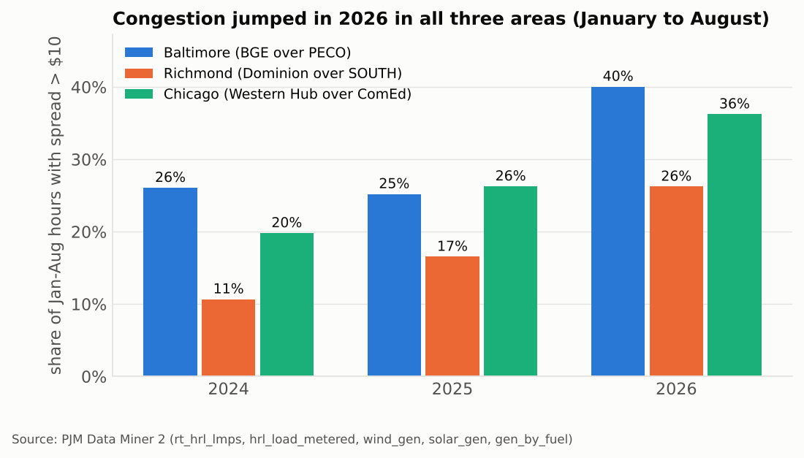
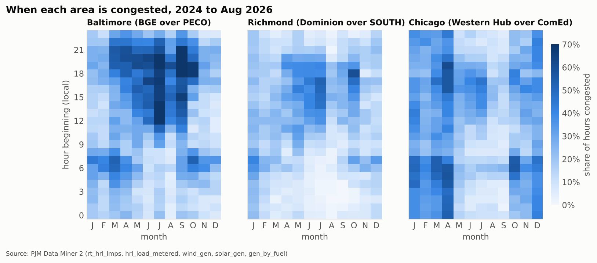
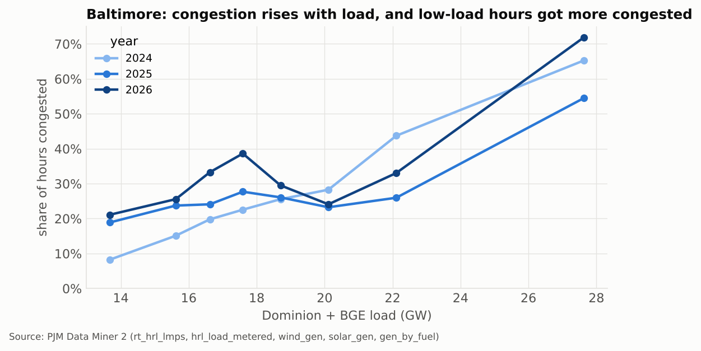
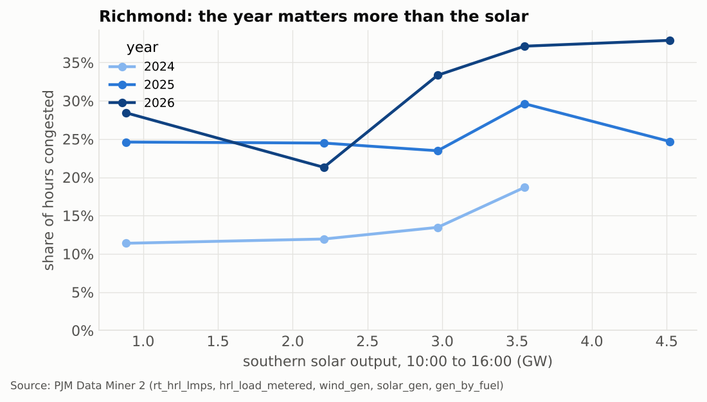
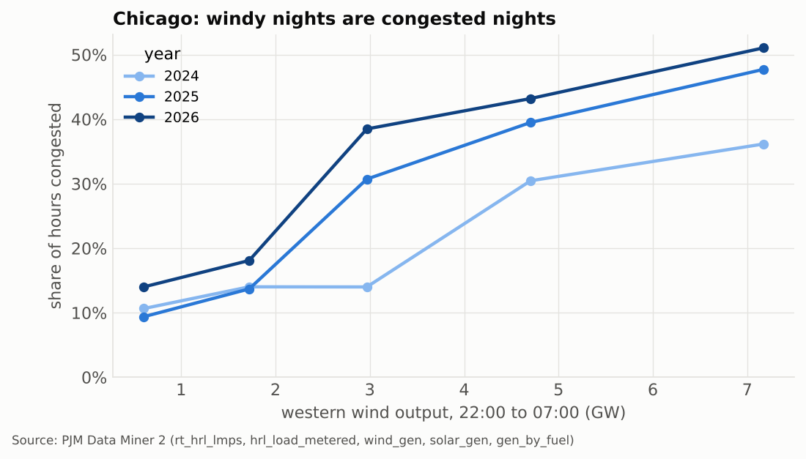
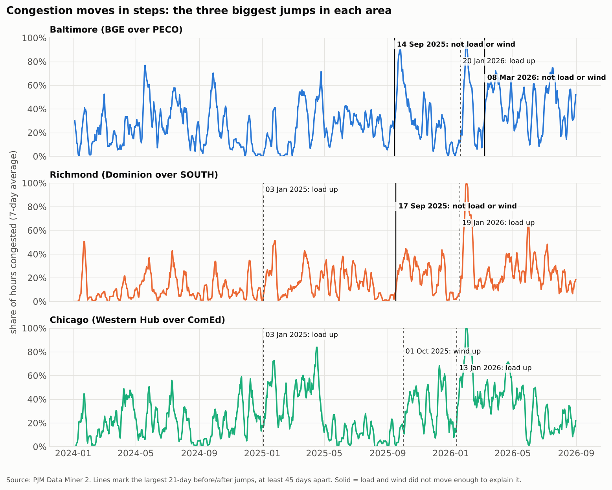
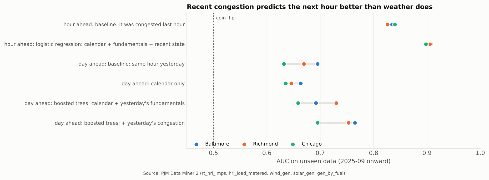
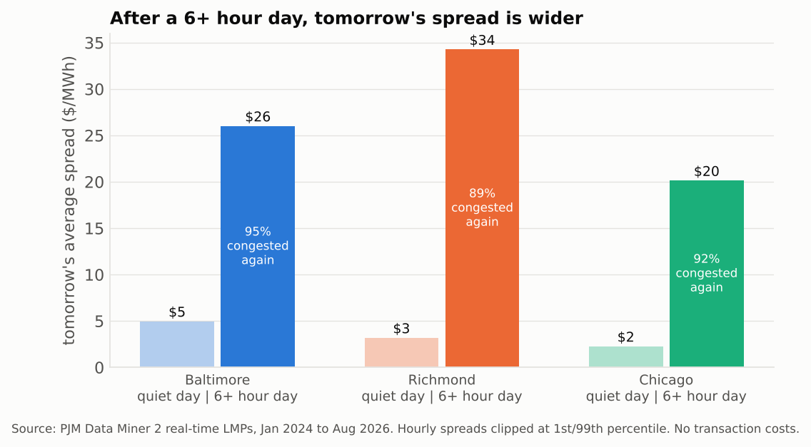

# Why PJM Flowgates Bind

A study of when and why three parts of the PJM grid get congested, built entirely on public data.

PJM runs the power grid and wholesale electricity market for all or parts of 13 US states and DC. When a transmission line in PJM hits its limit, it "binds". Cheap power gets stuck on one side, the grid has to run more expensive plants on the other, and prices split by location. The gap between those prices is the spread, and predicting it is a big part of what a power trading desk does.

I looked at three areas where that happens a lot: around **Baltimore**, **Richmond** and **Chicago**. For each one I wanted to answer two questions:

1. **When** is it congested? Which hours, which seasons, which conditions?
2. **Why?** Which fundamentals actually drive it, and which only look like they do?

## The short version

Weather and load explain **which hours** an area is congested. They don't explain **how often**.

- All three areas were far more congested in 2026 than in 2024, comparing January to August of each year. Western wind barely changed over that time.
- Each area has a clear daily and seasonal pattern tied to a fundamental: load for Baltimore, the middle of the day for Richmond, windy nights for Chicago.
- But the level keeps moving in ways those fundamentals can't account for. Three of the nine biggest jumps in congestion happened with flat or falling load and no nearby plant retirements.
- For prediction, that means recent congestion beats the weather. A simple rule, "if it was congested for six or more hours today, take tomorrow's spread", works in all three areas, including on data the analysis never trained on.

## Background: how congestion shows up in prices

Every location on the PJM grid has its own price, called a locational marginal price (LMP). PJM splits each LMP into three parts:

- **energy**: the same everywhere at a given hour
- **losses**: the cost of power lost moving across the wires
- **congestion**: what transmission limits are adding or subtracting at that location

When nothing is binding, the congestion part is close to zero everywhere. When a line binds, it goes up on the side that can't get enough power and down on the side where power is stuck. So the difference in congestion prices between two locations is a clean, public signal of whether the grid between them is constrained.

A useful rule of thumb: **the expensive side is where the power wants to go, and the cheap side is where it's stuck.**

## How I measured congestion

I measured congestion from prices rather than from named constraints. For each area I picked a pair of pricing nodes on either side of the congestion:

| Area | Expensive side | Cheap side | Power is trying to flow |
|---|---|---|---|
| Baltimore | BGE | PECO | south into BGE |
| Richmond | Dominion | SOUTH interface | north out of the Southeast |
| Chicago | Western Hub | ComEd | east out of northern Illinois |

The spread is the congestion price on the expensive side minus the cheap side. **An hour counts as congested when that spread is above $10/MWh.**

Two choices worth explaining:

- **Why a price spread and not a named flowgate?** A spread picks up every constraint between the two nodes, not just one line. That makes it a broader measure, but it's fully public and reproducible, and it's what a trader actually gets paid on.
- **Why $10?** It's high enough to ignore noise and low enough to catch normal congested hours. I reran the year-by-year comparison at $5 and $20 and the pattern is the same ([results/congested_share_by_year.csv](results/congested_share_by_year.csv)).

## Data

Everything is public. The raw files aren't committed, but they all come from these sources:

| Data | Source | What it's for |
|---|---|---|
| Real-time hourly LMPs, 46 nodes | PJM Data Miner 2 | congestion spreads |
| Hourly metered load by zone | PJM Data Miner 2 | is it load? |
| Wind generation by region | PJM Data Miner 2 | is it wind? |
| Solar generation by region | PJM Data Miner 2 | is it solar? |
| Generation by fuel type | PJM Data Miner 2 | what's running, including nuclear |
| Generator inventory (August 2026) | [EIA-860M](https://www.eia.gov/electricity/data/eia860m/) | did a nearby plant retire? |

The period is January 2024 to August 2026: 23,373 hours.

## Method

### 1. Put everything on one clock

This is the least exciting step and the one that matters most. PJM publishes prices and load **hour-ending** (hour 1 is midnight to 1am) and wind, solar and fuel mix **hour-beginning** (hour 0 is midnight to 1am). Join them as they are and every relationship is off by an hour, so you end up explaining the wrong hour.

I didn't take the labels on trust. I checked each file two ways ([results/clock_checks.md](results/clock_checks.md)):

- **Spring-forward days.** On the day the clocks jump from 2am to 3am, a file labelled hour-beginning is missing hour 2 and a file labelled hour-ending is missing hour 3. Prices and load were missing hour 3. Wind, solar and fuel mix were missing hour 2. That confirms the conventions.
- **Lag check.** After shifting everything to hour-beginning, two series that should move together should line up best at zero lag. Solar from the solar feed and solar from the fuel-mix feed correlate at 0.998 at zero lag, against 0.96 one hour off. Load and the energy price also peak at zero lag.

### 2. Build one hourly table

All six sources go into one table, one row per hour: congestion and total prices at 46 nodes, load for each zone, wind and solar by region, and output by fuel type.

### 3. Compare within a year, never across

Congestion rose a lot over the period. If you pool all the years together, anything else that also rose (load, solar, data center demand) will look like it drives congestion, even if it doesn't. So every comparison in this project is made **within a single year**, and years are only compared on the same months (January to August, since the data ends in August 2026).

### 4. Look for step changes

Instead of only asking "what drives congestion?", I also asked "**when did it change?**" For each area I took the daily share of congested hours, compared the 21 days after every date with the 21 days before, and kept the three biggest jumps at least 45 days apart. Then, for each jump, I checked whether load, wind, solar or nuclear output moved at the same time, and whether any generator retired within 60 miles.

### 5. Test on data the models never saw

Models are trained on January 2024 to August 2025 and scored on September 2025 onward. Every model is compared with a baseline that needs no model at all, because a model is only useful if it beats the obvious answer.

## Findings

### Congestion jumped in 2026 in all three areas



Comparing January to August of each year, Baltimore was flat from 2024 to 2025 (26%, then 25%) and jumped to 40% in 2026. Richmond and Chicago rose every year. Over the same months, Dominion load rose 16%, southern solar 36%, and western wind only 6% ([results/fundamentals_by_year.csv](results/fundamentals_by_year.csv)).

### Each area has its own hours



- **Baltimore** is congested on summer and September afternoons and evenings, and on winter mornings.
- **Richmond** is congested in the afternoon, mostly in late spring, summer and October.
- **Chicago** is congested at night, mostly in winter, spring and October.

Three different patterns, which already suggests three different drivers.

### Baltimore: load explains the hour, not the whole level



More Dominion and BGE load means more congestion, in every year. In 2024 the lowest-load hours were congested 8% of the time and the highest-load hours 65%. That's a real load effect.

But look at the left side of the chart. The lowest-load hours went from 8% congested in 2024 to 19% in 2025 and 21% in 2026. At the same load, the line got tighter. Load growth alone can't explain that.

### Richmond: the year matters more than the solar



Richmond's congestion peaks in the middle of the day, so I expected solar to drive it. It doesn't, at least not within a year. In 2025, midday congestion sits between 23% and 30% no matter how much southern solar is running. The gap between years is much bigger than anything solar explains.

### Chicago: windy nights, and more of them congested each year



At night, the windiest hours are congested 36% to 51% of the time, against 9% to 14% for the calmest. That fits wind in the west producing more power than can get east out of northern Illinois.

Load barely matters at night. In 2025, windy low-load nights were congested 44% of the time and calm high-load nights 11% ([results/chicago_wind_load_grid.csv](results/chicago_wind_load_grid.csv)).

The catch: at the same wind level, around 3 GW, congestion went from 14% in 2024 to 31% in 2025 and 38% in 2026, while average western wind rose only 6%. Same wind, much more congestion.

### Congestion moves in steps, and not every step is weather



Of the nine biggest jumps across the three areas, six line up with an obvious fundamental: winter cold snaps that pushed load up 13% to 22%, and a wind ramp in the west in October 2025.

Three don't:

| Area | Date | Congested before | After | What load did |
|---|---|---|---|---|
| Baltimore | 14 Sep 2025 | 18% | 69% | Dominion load -0.4% |
| Richmond | 17 Sep 2025 | 4% | 34% | Dominion load +0.6% |
| Baltimore | 8 Mar 2026 | 19% | 62% | Dominion load -8%, BGE load -17% |

No generator retired within 60 miles of any of those dates (EIA-860M). The two September jumps line up with a 6% to 7% dip in PJM nuclear output, which is fall refueling season, so that's one candidate. A transmission outage or a switching change is the other. PJM's outage history is what would tell them apart, and it's the first thing I'd pull next ([results/step_changes.csv](results/step_changes.csv)).

### Recent congestion predicts better than the weather



AUC measures how well a model ranks congested hours above uncongested ones: 0.5 is a coin flip and 1.0 is perfect. All scores are on September 2025 onward, which the models never saw.

**Hour ahead**
- Baseline, "it was congested last hour": 0.83 to 0.84
- Logistic regression on calendar, fundamentals and recent congestion: 0.90 to 0.91

**Day ahead** (yesterday's weather and load stand in for a forecast)
- Calendar only (hour, month, weekend): 0.64 to 0.66
- Gradient-boosted trees on calendar plus yesterday's fundamentals: 0.66 to 0.73
- Adding yesterday's congestion: 0.70 to 0.77

Weather and load add a little on top of the calendar. Recent congestion adds more. That's the same story as the step changes: once the grid is in a congested state, it tends to stay there ([results/model_auc.csv](results/model_auc.csv)).

### Bet on the regime, not the hour



If congestion persists, the simplest trade is on persistence:

> **If an area was congested for six or more hours today, take tomorrow's spread.**

I tested it as a paper trade: 1 MW, receiving the real-time spread every hour tomorrow, with no costs. Hourly spreads are clipped at the 1st and 99th percentiles so a single cold snap can't decide the answer.

| Area | Congested again tomorrow | Avg spread tomorrow after a 6+ hour day | After a quiet day | Test period only (Sep 2025 on) |
|---|---|---|---|---|
| Baltimore | 95% | $26 | $5 | $34 vs $11 |
| Richmond | 89% | $34 | $3 | $46 vs $6 |
| Chicago | 92% | $20 | $2 | $27 vs $5 |

Two checks on whether I fooled myself:

- **Is six a cherry-picked number?** No. Tomorrow's spread rises steadily with today's congested hours at 1, 3, 6 and 12 hours. For Baltimore it goes $20, $22, $26, $35. Six is a middle value, not a tuned one.
- **Is the average driven by a few huge hours?** Partly. The median day is much smaller than the average: about $6 for Baltimore after a 6+ hour day, against close to $0 after a quiet day. The gap is still there, but most of the money is in the tail ([results/regime_rule.csv](results/regime_rule.csv)).

## What this means for a desk

- **Forecast the state, not just the weather.** The most useful question isn't "how hot will it be tomorrow?" but "is whatever tightened this line still in place?"
- **Watch for step changes.** The biggest moves came in a few days and then stayed. The first days after a switch are where a desk that's paying attention would have an edge over one still pricing last month's pattern.
- **Use weather for timing.** Within a congested regime, load, solar and wind still tell you which hours to expect it.

## Limits

I'd rather be clear about these than have someone find them:

- **No outage, import or forecast data.** The three unexplained jumps are flagged, not explained.
- **Spreads, not single flowgates.** A spread between two nodes captures every constraint between them.
- **Real-time only, no costs.** The rule hasn't been tested against day-ahead prices, which is where the market would already price some of this persistence.
- **Hourly data.** Hourly averages hide congestion that only lasts a few five-minute intervals.

## Next steps

1. Pull PJM's transmission outage history for 14 Sep 2025, 17 Sep 2025 and 8 Mar 2026.
2. Add day-ahead LMPs and test the regime rule against the day-ahead spread.
3. Repeat the analysis on PJM's published binding-constraint data for named flowgates.

## Run it yourself

```
pip install -r requirements.txt
python run_all.py
```

Put these files in `data/raw/` first:

| File | Source |
|---|---|
| `rt_hrl_lmps.csv` | PJM Data Miner 2, real-time hourly LMPs |
| `hrl_load.csv` | PJM Data Miner 2, hourly metered load |
| `wind_gen.csv` | PJM Data Miner 2, wind generation |
| `solar_gen.csv` | PJM Data Miner 2, solar generation |
| `gen_by_fuel.csv` | PJM Data Miner 2, generation by fuel type |
| `eia860m_aug2026.xlsx` | EIA-860M, August 2026 |

The expected columns are at the top of each loader in `src/build_table.py`. A full run takes about 30 seconds and rebuilds every table in `results/` and every chart in `charts/`.

## Repo layout

```
src/config.py         areas, node pairs, thresholds, train/test split
src/build_table.py    raw files into one hourly table on one clock
src/checks.py         the hour-label checks
src/explore.py        congestion by year, hour, month, load, solar and wind
src/step_changes.py   the biggest jumps and what moved with them
src/models.py         hour-ahead and day-ahead models against baselines
src/regime.py         the six-hour rule
results/              the tables behind every number in this README
charts/               the charts in this README
docs/glossary.md      plain-language definitions
run_all.py            runs everything in order
```

Built in Python with pandas, scikit-learn and Matplotlib.

## Author

Tanisha Mattapalli
